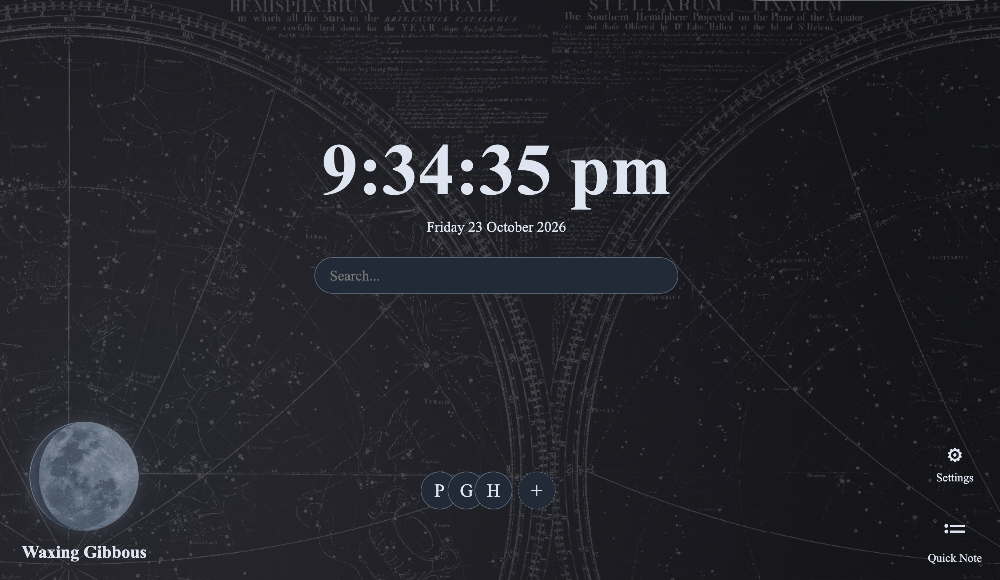

# NewTab

I made a custom new tab page themed around an astronomy aesthetic. 

## Features

 - Working search bar
 - Items that update:
    - Moon Phase
    - Time
    - Date
- Personalized bookmarks
- Quick notes feature
- Different themes


## Demo Link
https://elliewoodward2024-ops.github.io/NewTab/

## Images



 
## Installation to run locally

1. You will need to Clone the repository: 
   ```
   git clone https://github.com/elliewoodward2024-ops/NewTab.git
2. Open the project in your code editor such as VS Code.
3. Open `index.html` in your browser. 


#### AI USAGE
Usage was to fix couple errors that I couldn't seem to identify. Helped mainly with the creation of the 
moon phase section. No other usage otherwise. 
